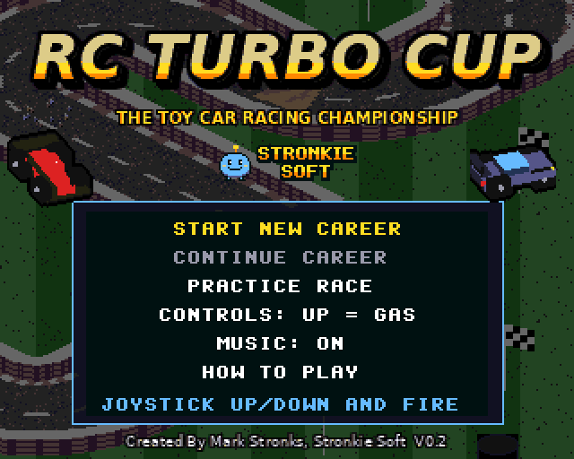
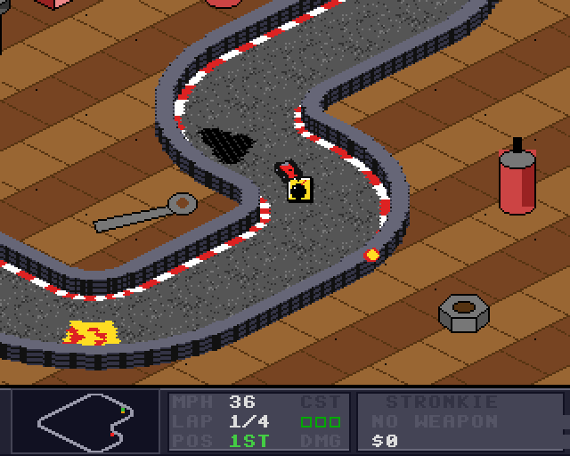
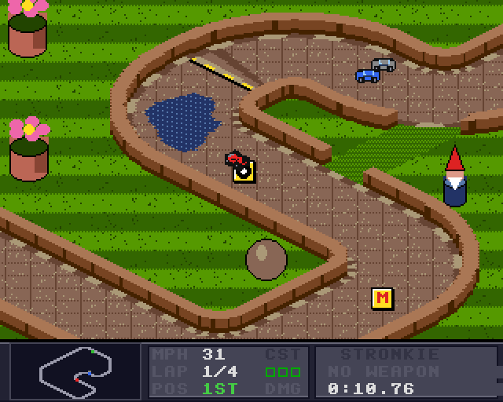
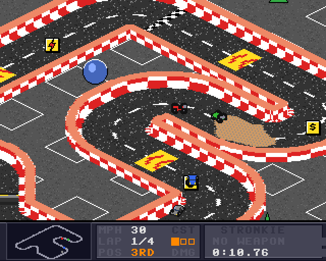
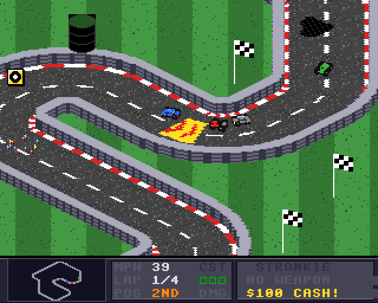
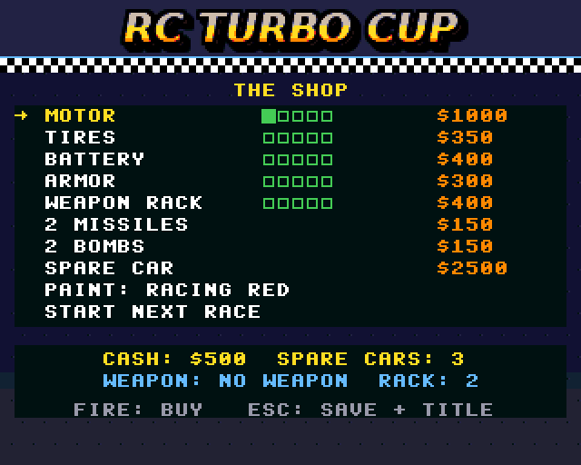

# RC Turbo Cup



**Isometric toy car racing for the Amiga 500.** Race a radio controlled toy car through oversized rooms against Speedy Sam, Careful Carla, Mad Max and Engineer Erik. Collect upgrades and weapons on the track, spend your prize money in the shop and win three cups.

Created By Mark Stronks, Stronkie Soft © 2026

Written in 68000 assembly for a stock Amiga 500 with Kickstart / Workbench 1.3 and a 512K trapdoor expansion (1 MB). Runs from a bootable disk (or a Gotek), from hard drive / CF card and with WHDLoad. Play it with a **joystick** in port 2 (or the keyboard).

**Latest version: V0.2 - TEST VERSION.** On itch.io: https://stronkie.itch.io/rc-turbo-cup

## Features

- **Scrolling isometric tracks** with walls, kerbs and giant props, in 32 colours with hardware scrolling, and a HUD with a minimap, speed, lap, place, weapon, cash and your STRONKIE letters
- **8 tracks** in 8 toy worlds: Garage Grand Prix, Living Room Rally, Garden Sprint (with a grass shortcut), Toy Store Dash, Playground Pursuit, Science Lab Circuit, Construction Crash and the Championship Arena
- **4 cars, 4 laps**: finish in the top 3 to go on, 4th place costs a spare car and a retry
- **Career**: Amateur Cup, National Cup and World Championship, 8 races each, with prize money, points and gold / silver / bronze trophies
- **4 rivals with their own personality**: Speedy Sam (fast, crashes), Careful Carla (steady), Mad Max (fires at you and rams you) and Engineer Erik (goes for every power-up)
- **Pickups on the track**: motor, tires and battery (permanent upgrades), missiles, bombs, homing missiles, cash, roll cage, turbo, shield and repair; the computer cars use the weapons and power-ups too, but the upgrades, the cash and the letters are only for you
- **15 colour cars**: attached sprite pairs with outlines, glass, tyres, head and tail lights, in 5 designs and 16 directions
- **STRONKIE letters**: collect S-T-R-O-N-K-I-E over the races for the next car (Rookie Buggy, Sport RC, Turbo RC, Super RC, Champion RC), $2000 and a new paint job
- **Weapons**: missiles, homing missiles and bombs; explosions spin the car round
- **Track hazards**: zippers, ramps (jumps), oil, marbles, water, sand, loose batteries and electric plates
- **Weather** in the later cups: rain (slippery) and wind
- **The shop**: motor, tires, battery, armor, weapon rack, missiles, bombs, spare cars and paint
- **Practice** on any track, best laps saved
- Music for the title, four race themes, the shop, winning and losing; motor sound; voices ("three, two, one, go!", "finish!")
- Your career is saved on the disk (or the hard drive / WHDLoad)

## Screenshots












## Download and run

| File | What it is |
|---|---|
| `RCTurboCup_V0.2.adf` | Bootable disk. Boot it, or put it on a Gotek, and the game starts by itself. To put the game on your hard drive: boot Workbench from the hard drive, insert this disk and double click **Install** |
| `whdload/RCTurboCup_V0.2_WHDLoad.lha` | **WHDLoad version** (also as `.zip`): unpack on your hard drive and double click `RCTurboCup`. Own slave (`src/whdload.s`), no Kickstart image needed, F10 quits |
| `RCTurboCup_V0.2_harddrive.zip` | Drawer `RCTurboCup` with the game, the tracks, its icon and the ReadMe: copy it and double click `RCTurbo` |
| `demo/` | The **free demo**: the first 2 races of the Amateur Cup and practice on those 2 tracks (ADF and WHDLoad), nothing is saved |
| `print/` | The **print kit**: an 8 page manual (A5), a box to print and fold with the system requirements (A3, and an A4 mini) and disk labels (A4) as PDF |
| `previous_versions/` | Older versions (V0.1) |

**Requirements:** Amiga 500 (or any Amiga with a 68000) with Kickstart 1.3 and 1 MB: 512K chip + 512K trapdoor. Joystick in port 2.

## Controls

| | |
|---|---|
| Left / right | steer |
| Up | gas (or **fire = gas**: switch it on the title screen) |
| Down | brake / reverse |
| Fire, Space, 2nd button | use your weapon |
| P / Esc | pause (Esc again: quit the race) |
| M | music on / off |

## Building

```
sh tools/build.sh          # VER=0.1 by default
```

Needs python3 with Pillow and numpy. Everything else is in `tools/`:

- `tracks.py` - the 8 tracks: layouts, the isometric pictures (ground, road, kerbs, walls, props, hazards), the surface maps and the racing lines
- `sprites.py` - the cars (5 designs x 16 directions, with and without roll cage), missiles, bombs and explosions
- `make_gfx.py` - the track files, pickups, HUD, title and menu screens, sounds, voices and music
- `lz.py` - the packer (the game unpacks with `unlz`)
- `make_loading.py` - the loading picture (and the itch cover)
- `asm68k.py` - a small 68000 assembler that writes Amiga hunk executables
- `make_disk.py` - the bootable OFS disk, Workbench icons and the hard drive zip
- `make_whdload.py` - the WHDLoad package (also the demo's)
- `make_print.py` - the print kit: manual, box and disk labels
- `emu68k.py`, `harness.py`, `autopilot.py`, `test_whdload.py`, `test_install.py`, `shots_v01.py` - a small A500 test bench (with scrolling and copper splits): whole races with a joystick autopilot, WHDLoad and the installer

Source: `src/main.s` (the full game) and `src/demo.s` (the demo) include `src/rc.s` (start-up, display, scrolling, sprites, unpacking, text, input, sound), `src/race.s` (cars, physics, computer drivers, weapons, pickups, laps, HUD, camera), `src/menus.s` (title, career, shop, results, practice, track loading, saving), `src/loader.s` (the loader with the loading picture), `src/install.s` (the hard disk installer) and `src/whdload.s` (the WHDLoad slave).

## Version history

### V0.2 - TEST VERSION - 20 November 2026
- New cars: 15 colours each (attached sprite pairs) with a dark outline, two body shades, glass, black tyres, head and tail lights - in all 5 designs, with and without roll cage
- Missiles, bombs and explosions are now drawn into the track (the cars use all 8 sprites)
- The computer cars no longer take the motor, tires, battery, cash or the STRONKIE letters: those are only for you. They still use the weapons, roll cages, turbos, shields and repair kits
- Engineer Erik now goes for the power-ups
- A free demo: the first 2 races of the Amateur Cup and practice on those 2 tracks
- A print kit: 8 page manual, a fold-up box with the system requirements and disk labels

### V0.1 - TEST VERSION - 20 November 2026
- The first version: 8 scrolling isometric tracks, 4 cars, career with 3 cups, shop, pickups and weapons, STRONKIE letters, weather, practice, ADF, hard drive and WHDLoad versions

Created By Mark Stronks, Stronkie Soft

## Print kit

The manual, the box and the disk labels (PDF) are in `print/`.

Print kit on itch: 2026-11-20 (manual, box and disk labels as free downloads)
