# Stronkie's RC Cup

*(Called RC Turbo Cup up to V0.4.)*

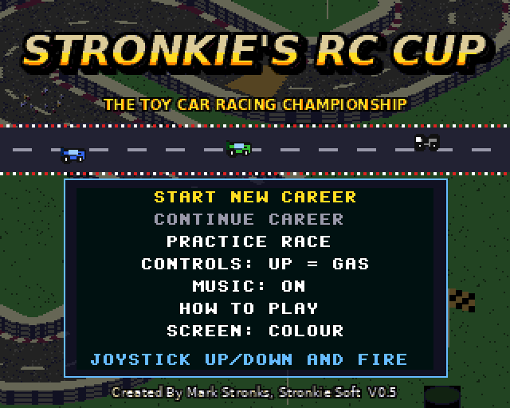

**Isometric toy car racing for the Amiga 500.** Race a radio controlled toy car through oversized rooms against Speedy Sam, Careful Carla, Mad Max and Engineer Erik. Collect upgrades and weapons on the track, spend your prize money in the shop and win three cups.

Created By Mark Stronks, Stronkie Soft © 2026

Written in 68000 assembly for a stock Amiga 500 with Kickstart / Workbench 1.3 and a 512K trapdoor expansion (1 MB). Runs from a bootable disk (or a Gotek), from hard drive / CF card and with WHDLoad. Play it with a **joystick** in port 2 (or the keyboard).

**Latest version: V0.5.1 - TEST VERSION.** On itch.io: https://stronkie.itch.io/rc-turbo-cup

## Features

- **Scrolling isometric tracks** with walls, kerbs and giant props, in 32 colours with hardware scrolling, and a HUD with a minimap, speed, lap, place, weapon, cash and your STRONKIE letters
- **10 tracks** in 10 toy worlds: Garage Grand Prix, Living Room Rally, Garden Sprint (with a grass shortcut), Toy Store Dash, Playground Pursuit, Science Lab Circuit, Construction Crash, the Championship Arena, the Kitchen Table Trophy and a secret track to unlock
- **Backwards races**: the National Cup races every track the other way round, the World Championship every second race
- **4 cars, 4 laps**: finish in the top 3 to go on, 4th place costs a spare car and a retry
- **Career**: Amateur Cup, National Cup and World Championship, 9 races each, with prize money, points and gold / silver / bronze trophies
- **Unlockables**: gold in a cup opens the secret track, gold in all three cups gives you THE GOLDEN CAR
- **Time trial** against the ghost of your best lap, saved on the disk
- **STRONKIE POCKET**: play the race on a little handheld with a simple 4 shade grey LCD, like back in the day (dual playfield)
- **Start lights gantry and big texts** (LAP 2, FINAL LAP!, FINISH!, NEW RECORD!), flashing zippers, flags and electric plates
- **Title intro**: toy cars race across the title, the logo wobbles on the beat
- **4 rivals with their own personality**: Speedy Sam (fast, crashes), Careful Carla (steady), Mad Max (fires at you and rams you) and Engineer Erik (goes for every power-up)
- **Pickups on the track**: motor, tires and battery (permanent upgrades), missiles, bombs, homing missiles, cash, roll cage, turbo, shield and repair; the computer cars use the weapons and power-ups too, but the upgrades, the cash and the letters are only for you
- **15 colour cars**: attached sprite pairs with outlines, glass, tyres, head and tail lights, in 5 designs and 16 directions
- **STRONKIE letters**: collect S-T-R-O-N-K-I-E over the races for the next car (Rookie Buggy, Sport RC, Turbo RC, Super RC, Champion RC), $2000 and a new paint job
- **Weapons**: missiles, homing missiles and bombs; explosions spin the car round
- **Track hazards**: zippers, ramps (jumps), oil, marbles, water, sand, loose batteries and electric plates
- **Weather** in the later cups: rain (slippery) and wind
- **The shop**: motor, tires, battery, armor, weapon rack, missiles, bombs, spare cars and paint
- **Practice** on any track, best laps saved
- Music with drums: 4 channels on the title and in the shop, lead, bass and drums in the races (with your motor on the 4th); the motor sings higher with every motor upgrade; voices ("three, two, one, go!", "finish!") and a crowd at the finish
- Your career is saved on the disk (or the hard drive / WHDLoad)

## Screenshots

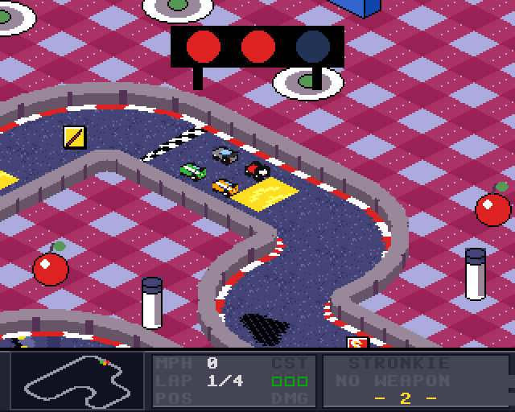
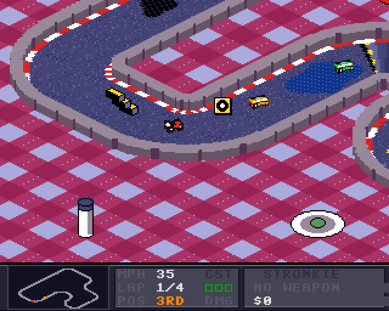
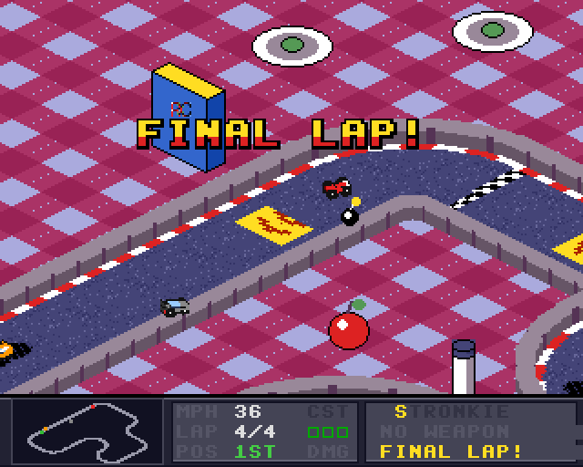
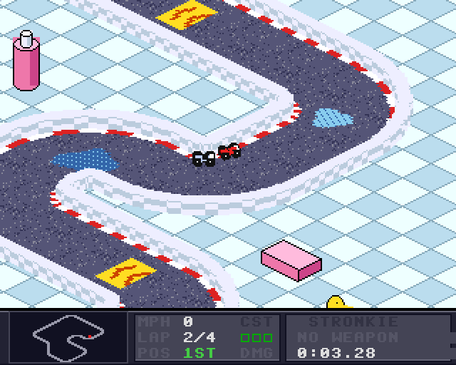
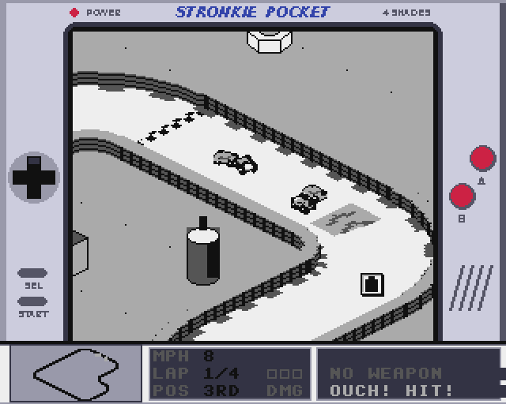
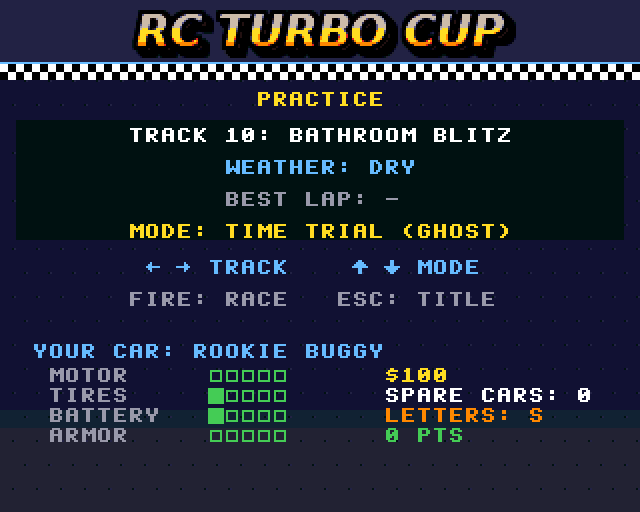

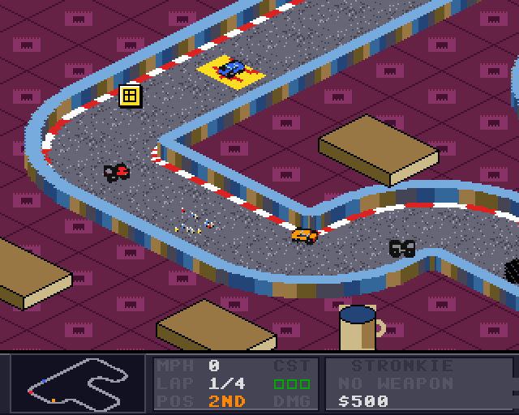

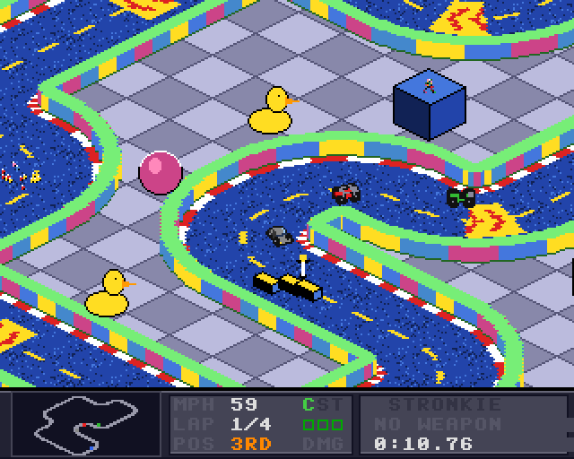

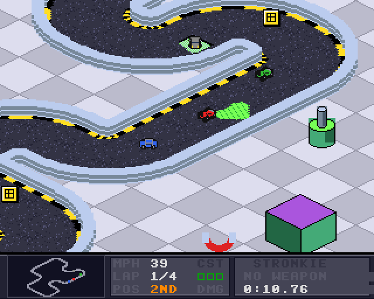

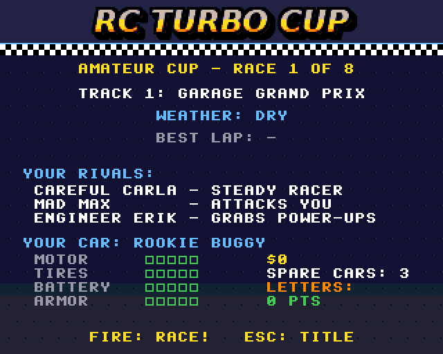
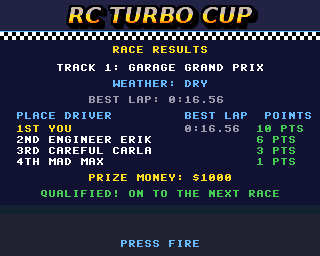


## Download and run

| File | What it is |
|---|---|
| `StronkiesRCCup_V0.5.1.adf` | Bootable disk. Boot it, or put it on a Gotek, and the game starts by itself. To put the game on your hard drive: boot Workbench from the hard drive, insert this disk and double click **Install** |
| `whdload/StronkiesRCCup_V0.5.1_WHDLoad.lha` | **WHDLoad version** (also as `.zip`): unpack on your hard drive and double click `StronkiesRCCup`. Own slave (`src/whdload.s`), no Kickstart image needed, F10 quits |
| `StronkiesRCCup_V0.5.1_harddrive.zip` | Drawer `StronkiesRCCup` with the game, the tracks, its icon and the ReadMe: copy it and double click `RCCup` |
| `demo/` | The **free demo** (made from V0.2): the first 2 races of the Amateur Cup and practice on those 2 tracks (ADF and WHDLoad), nothing is saved |
| `print/` | The **print kit**: an 8 page manual (A5), a box to print and fold with the system requirements (A3, and an A4 mini) and disk labels (A4) as PDF |
| `previous_versions/` | Older versions (V0.1 - V0.4 under the old name RC Turbo Cup, and V0.5) |

**Requirements:** Amiga 500 (or any Amiga with a 68000) with Kickstart 1.3 and 1 MB: 512K chip + 512K trapdoor. Joystick in port 2.

## Controls

| | |
|---|---|
| Left / right | steer |
| Up | gas (or **fire = gas**: switch it on the title screen) |
| Down | brake / reverse |
| Fire, Space, 2nd button | use your weapon |
| P / Esc | pause (Esc again: quit the race) |
| M | music on / off |

## Building

```
VER=0.5.1 sh tools/build.sh
```

Needs python3 with Pillow and numpy. Everything else is in `tools/`:

- `tracks.py` - the 10 tracks: layouts, the isometric pictures (ground, road, kerbs, walls, props, hazards), the surface maps and the racing lines
- `sprites.py` - the cars (5 designs x 16 directions, with and without roll cage), missiles, bombs and explosions
- `make_gfx.py` - the track files, pickups, HUD, title and menu screens, sounds, voices and music
- `lz.py` - the packer (the game unpacks with `unlz`)
- `make_loading.py` - the loading picture (and the itch cover)
- `asm68k.py` - a small 68000 assembler that writes Amiga hunk executables
- `make_disk.py` - the bootable OFS disk, Workbench icons and the hard drive zip
- `make_whdload.py` - the WHDLoad package (also the demo's)
- `make_print.py` - the print kit: manual, box and disk labels
- `emu68k.py`, `harness.py`, `autopilot.py`, `test_whdload.py`, `test_install.py`, `shots_v01.py` - a small A500 test bench (with scrolling and copper splits): whole races with a joystick autopilot, WHDLoad and the installer

Source: `src/main.s` (the full game) and `src/demo.s` (the demo) include `src/rc.s` (start-up, display, scrolling, sprites, unpacking, text, input, sound), `src/race.s` (cars, physics, computer drivers, weapons, pickups, laps, HUD, camera), `src/menus.s` (title, career, shop, results, practice, time trial, track loading, saving), `src/retro.s` (the STRONKIE POCKET), `src/loader.s` (the loader with the loading picture), `src/install.s` (the hard disk installer) and `src/whdload.s` (the WHDLoad slave).

## Version history

### V0.5.1 - TEST VERSION - 21 November 2026
- The title screen stays put: the logo wobble on the beat no longer shifts the menu below it, and the wobble is gentler
- STRONKIE POCKET: missiles, bombs and explosions are grey with black outlines now, easy to see on the LCD

### V0.5 - TEST VERSION - 21 November 2026
- The game is now called **Stronkie's RC Cup**: new title logo, loading picture, menus, manual, box and labels
- New file names: StronkiesRCCup_V0.5.1.adf, the drawer StronkiesRCCup, the game RCCup (your career is now RCCup.dat)
- STRONKIE POCKET: a simple 4 shade grey screen like the old handhelds - a white road, a flat grey ground, black and white kerbs, walls and props in 3 shades, light grey cars with black outlines
- STRONKIE POCKET: the big texts (LAP 2, FINAL LAP! ...) are black with a white outline and no longer flicker; the pickups are black and white and easy to read

### V0.4 - TEST VERSION - 21 November 2026
- Two new tracks: the Kitchen Table Trophy (in the cups) and the Bathroom Blitz (secret)
- The cups have 9 races now; the National Cup races every track backwards, the World Championship every second race
- Unlockables: a gold trophy opens the secret track in practice, gold in all three cups gives you THE GOLDEN CAR (a paint in the shop, a little faster)
- Time trial (in practice): race alone against the ghost of your best lap; the ghost is saved on the disk
- Practice modes: race, race backwards, time trial
- STRONKIE POCKET: switch SCREEN on the title and play the race on a little handheld with a 4 shade green LCD
- A start lights gantry over the grid and big texts: LAP 2, LAP 3, FINAL LAP!, FINISH!, NEW RECORD!
- Animated track details: flashing zipper arrows, waving flags, crackling electric plates, camera flashes in the crowd
- Title intro: toy cars race across the title and the logo wobbles on the beat
- Music with drums (kick, snare, hi-hat) and arpeggios: 4 channels on the title and in the shop; the race tunes get drums too
- A crowd cheers when you finish; the motor sings higher with every motor upgrade
- The WHDLoad version saves the career and the ghosts

### V0.3 - TEST VERSION - 20 November 2026
- Much easier to get loose from the walls: the car keeps at least half its steering even when it stands still, is pushed a little back towards the track after a wall hit, and turns towards the track by itself when it is slow against a wall

### V0.2 - TEST VERSION - 20 November 2026
- New cars: 15 colours each (attached sprite pairs) with a dark outline, two body shades, glass, black tyres, head and tail lights - in all 5 designs, with and without roll cage
- Missiles, bombs and explosions are now drawn into the track (the cars use all 8 sprites)
- The computer cars no longer take the motor, tires, battery, cash or the STRONKIE letters: those are only for you. They still use the weapons, roll cages, turbos, shields and repair kits
- Engineer Erik now goes for the power-ups
- A free demo: the first 2 races of the Amateur Cup and practice on those 2 tracks
- A print kit: 8 page manual, a fold-up box with the system requirements and disk labels

### V0.1 - TEST VERSION - 20 November 2026
- The first version: 8 scrolling isometric tracks, 4 cars, career with 3 cups, shop, pickups and weapons, STRONKIE letters, weather, practice, ADF, hard drive and WHDLoad versions

Created By Mark Stronks, Stronkie Soft

## Print kit

The manual, the box and the disk labels (PDF) are in `print/`.

Print kit on itch: 2026-11-20 (manual, box and disk labels as free downloads)
